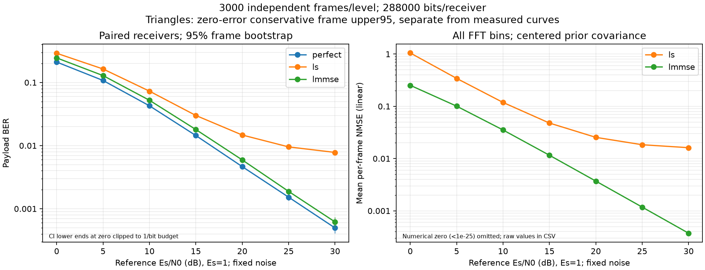
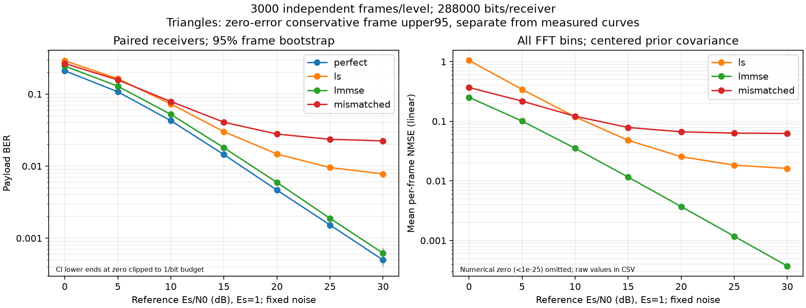

# Classical OFDM channel-estimation benchmark

In this stage I compared three receivers on exactly the same received frames:
Perfect CSI (knows the true channel), pilot LS with interpolation, and LMMSE, which
uses the channel's mean and covariance. I ran them over different channels, pilot
densities, modulations and noise levels. The original baseline still works as
before. I did not add any neural network or new dependency in this stage.

## How to reproduce

From the project folder, with the locked Python 3.12 environment:

```powershell
uv sync --locked
uv run python scripts/audit_baseline.py
uv run python scripts/run_classical_benchmark.py --frames 3000 --seed 2026
uv run python scripts/run_classical_benchmark.py --plots-only
uv run python scripts/diagnose_benchmark.py
uv run python scripts/validate_notebook.py
uv run python scripts/validate_notebook.py notebooks/02_classical_channel_estimation.ipynb
uv run pytest -q --basetemp=.pytest-tmp
uv run ruff check .
uv run ruff format --check .
```

Notebook 02 uses the real code from `src/neural_ofdm`, runs a small live example and
then loads the saved results. If the results folder is empty, run the benchmark
script first. `scripts/create_channel_estimation_notebook.py` can rebuild the
notebook from scratch, but that clears its outputs, so it has to be run again
afterwards. `--plots-only` redraws the figures from the saved CSV/JSON files.

Each study folder in `results/classical_benchmark/` has `metrics.csv`,
`paired_comparisons.csv`, `frame_errors.csv`, `metadata.json` and
`receiver_curves.png`. The extra figures are in `figures/`. The metadata lists the
real and assumed channel statistics, the noise levels, pilot and payload overhead,
how the random numbers were drawn, package versions and LMMSE solver details. I
don't store raw waveforms. The original baseline results were left untouched.
`results/baseline_audit/` holds a quick 500-frame sweep and the check against the
saved 10 dB baseline numbers.

## Code changes

| File | What it does |
|---|---|
| `src/neural_ofdm/modulation.py` | QPSK as before, plus Gray 16-QAM mapping and decisions |
| `src/neural_ofdm/config.py` | Grid, pilots (equal or unequal), overhead, noise mode and optional channel settings |
| `src/neural_ofdm/channel.py` | Old FIR/noise code plus sparse-delay Rayleigh/Rician channels, their statistics, and fixed noise |
| `src/neural_ofdm/estimation.py` | LS as before, plus LMMSE (prepared once, applied to every frame) |
| `src/neural_ofdm/equalization.py` | ZF as before, plus a simple per-bin MMSE equalizer |
| `src/neural_ofdm/simulation.py` | Split into "make a received frame" and "decode it", so all receivers can share one frame |
| `src/neural_ofdm/experiments.py` | The old sweep; it refuses fixed-noise mode so the two SNR axes don't get mixed up |
| `src/neural_ofdm/benchmark.py` | Study settings, paired runs, bootstrap intervals, saving and loading results |
| `src/neural_ofdm/benchmark_plotting.py` | Benchmark figures |
| `scripts/run_classical_benchmark.py` | Runs all studies, or only redraws the figures |
| `scripts/audit_baseline.py` | Re-runs the 10 dB baseline points and compares them to the saved counts |
| `scripts/validate_notebook.py` | Runs a notebook in a fresh kernel; now works for either notebook |
| `notebooks/02_classical_channel_estimation.ipynb` | Derivations, small live examples and the saved results |

The baseline defaults did not change: same QPSK mapping, channel powers, FFT scaling,
CP timing, pilots, SNR definition and order of random draws. The only intended
change is that `modulation_order=16` is now allowed, so the old test that rejected
16 now checks that 64 is rejected. The payload length follows the bits per symbol.
`OFDMConfig.channel=None` still gives the old channels; passing a `ChannelConfig`
turns on the new sparse-delay channels. When the old sweep is regenerated its
metadata gets a few new default fields, but the numbers stay the same.

`FrameResult.equalized_grid` is the raw equalizer output and `decision_grid` is what
the decisions are made on. For ZF they are the same. `simulate_frame(..., csi="lmmse")`
only builds LMMSE automatically in fixed-noise mode with the configured channel. The
benchmark builds each LMMSE filter once per noise level instead of every frame.

## Channel and noise

N=64, CP=16 samples, all bins used, perfect timing. The main Rayleigh channel has
taps at delays d=(0,1,3,6) samples, with an exponential power profile (tau=2.5 samples):

```text
p_l = exp(-d_l/tau) / sum(exp(-d/tau))
h_l ~ CN(0,p_l), independent complex Gaussian taps
E[sum(abs(h_l)^2)] = 1
```

In code the channel is a 7-tap FIR with zeros at the unused delays. The CP has to
cover the largest delay (6), not just the number of taps. A new channel is drawn for
each frame and kept constant during it, and single frames are not rescaled. Delays
are in samples; I don't claim any real time scale or Doppler.

For Rician fading I used one global K factor (LOS power / scattered power):

```text
h = sqrt(K/(K+1))*h_LOS + g/sqrt(K+1)
m_h = sqrt(K/(K+1))*h_LOS
C_h = diag(p)/(K+1)
```

The LOS path sits at delay 0 with energy one and phase 0. K=0 gives the Rayleigh
channel back exactly, K=1 is 0 dB and K=10 is 10 dB. The expected power on each tap
is `abs(m_h)^2+p/(K+1)`, so the total is still one. Raising K both shrinks the random
part and moves more power onto the first tap, so a change in results can't be blamed
on just one of these. Real Rician models often give each path its own K; mine is
simpler on purpose. [MathWorks fading-channel background](https://www.mathworks.com/help/comm/ug/fading-channels.html)
explains LOS and scattered parts in more detail.

The signal FFT/IFFT use `norm="ortho"` and the channel response is the plain FFT of
the taps, so with enough CP `Y[k]=H[k]*X[k]+W[k]`. Putting an extra 1/sqrt(N) on the
channel response would be wrong.

The old noise mode is still the default (received sample SNR):

```text
sigma^2 = P_received / 10^(snr_db/10)
```

Here the noise follows each frame's received power, so it depends on the channel.
That doesn't fit the LMMSE derivation, which assumes the noise is independent of the
channel. So for this benchmark I added a fixed-noise mode:

```text
Es = E[abs(data_symbol)^2] = 1
sigma^2 = Es / 10^(reference_esn0_db/10)
Var(real noise) = Var(imag noise) = sigma^2/2
```

`sigma^2` is the total complex noise variance and is the same for every frame at a
given level, whatever the channel or data. The unitary FFT keeps it the same on every
bin. Now a deep fade really lowers the received SNR. I call this axis "reference
Es/N0". It is not the old received SNR and not Eb/N0. I don't rescale the noise after
drawing it, so a single frame's noise power can differ a little from the target.

## Frequency covariance and the LMMSE formula

With L taps I use the plain Fourier matrix:

```text
F[k,l] = exp(-j*2*pi*k*d_l/N)             F: (N,L)
H = F*h                                H: (N,)
m_H = F*m_h                            m_H: (N,)
R_H = F*C_h*F^H                        R_H: (N,N)
```

`^H` is the conjugate transpose. `R_H` is the covariance around the mean (it is
Hermitian and positive semidefinite). The raw second moment is `R_H+m_H*m_H^H`, which
is different when there is a fixed LOS part. For Rayleigh the mean is zero and
`C_h=diag(p)`. For Rician I keep the mean and the random part separate.

For P pilots:

```text
Y_p = D_p*H_p + W_p                     D_p: (P,P), known nonzero pilots
z_p = D_p^(-1)*Y_p                      z_p: (P,)
R_znoise = sigma^2*diag(1/abs(X_p)^2)    R_znoise: (P,P)
m_P = m_H[p]                           m_P: (P,)
R_HP = R_H[:,p]                        R_HP: (N,P)
R_PP = R_H[p,p]                        R_PP: (P,P)
H_hat = m_H + A*(z_p-m_P)               A: (N,P)
A*(R_PP+R_znoise) = R_HP
H_hat = m_H + R_HP*solve(R_PP+R_znoise, z_p-m_P)
```

The second-to-last line comes from requiring the estimation error to be uncorrelated
with the pilot observations. That gives the smallest average squared error of any
estimator of the form "mean plus a matrix times the pilots". Because the channel and
noise are both Gaussian here, it is also the best estimator overall in that average
sense. I derived the complex version above; the
[Stanford estimation lecture](https://ee363.stanford.edu/archive/lectures/estim.pdf)
covers the background.

My code allows any nonzero complex pilots, including unequal powers, and takes the
noise variance as an input. It never looks at the test channel to get it. With noise,
I solve the system with a Cholesky factorization. With exactly zero noise the matrix
can be singular, so I only keep eigenvectors whose eigenvalues are above 1e-12 times
the largest one, instead of adding a small random "jitter". The filter is built once
per level and reused for every frame. None of the main runs needed any special
handling; the worst condition number was about 15,518 (spacing 2 at 30 dB). The
solver details are saved for every level.

The true H is only used by Perfect CSI and for computing errors. I have tests that
change the "truth" used for scoring while keeping the received frames the same, and
LS/LMMSE decisions do not change, so they are not secretly using it. Being optimal on
average does not mean LMMSE wins on every frame, every NMSE value or every BER point.

## How the experiments were run

There are nine studies, each at reference levels 0, 5, ..., 30 dB with 3,000 frames
per point and seed 2026. That is 189,000 frame evaluations in total, but the same
random draws are reused across levels and studies on purpose, so they are not
189,000 independent cases.

I use three random streams from `SeedSequence(seed).spawn(3)`: payload, channel and
noise. They restart at each level and each study, and all receivers (including the
mismatched one) decode the same frames. Across pilot layouts and modulations the
channels and the noise samples are the same, but the data and waveforms differ.
Across K values the random scattered part is the same but the channels differ.

BER is total payload errors divided by total payload bits. NMSE is the average over
frames of `||H_hat-H||^2/||H||^2`, over all bins, in linear units.
`ensemble_mse_per_bin` is the average squared error over all frames and bins, and
`ensemble_nmse` is total squared error divided by total channel energy. These are
three different averages. The one that LMMSE is supposed to minimize is the
ensemble MSE, not the per-frame NMSE.

For the error bars I resample whole frames 1,000 times (bootstrap), using the same
resampled frames for every receiver, and take the 2.5% and 97.5% points. Paired BER
differences between receivers are in `paired_comparisons.csv`. Resampling frames
handles the fact that bits in the same frame fail together, but with only a few
error frames the intervals are rough. The intervals are per point, not a band for
the whole curve.

When a receiver has zero errors I don't show a bootstrap interval. Instead, for F
frames with no frame errors, `q_upper=1-0.05^(1/F)` is a 95% upper bound on the
chance that a frame has any error, and since a frame's BER can't be bigger than that,
it also bounds the BER. For F=3000 this is about 0.000998079. The smaller bound for
288,000 bits, about 1.04018e-5, only holds if bits were independent, so I treat it as
a rough number. Zero errors never proves zero BER. In the figures the bounds are
triangles and the BER lines skip zero points. On log plots, interval ends at zero
are drawn at 1/(number of bits) and labeled; the CSV files have the real values.

## A. Receiver comparison

Rayleigh, QPSK, pilot spacing 4 (16 pilots), 96 bits per frame and 288,000 bits per
receiver per level. Error counts are in brackets. NMSE is the mean of per-frame values.

| Reference Es/N0 (dB) | Perfect BER (errors) | LS BER (errors) | LMMSE BER (errors) | LS NMSE | LMMSE NMSE |
|---:|---:|---:|---:|---:|---:|
| 0 | 0.210885 (60735) | 0.290375 (83628) | 0.245316 (70651) | 1.04987 | 0.252368 |
| 5 | 0.107618 (30994) | 0.163649 (47131) | 0.128583 (37032) | 0.342348 | 0.100723 |
| 10 | 0.0427014 (12298) | 0.0728889 (20992) | 0.0522604 (15051) | 0.118607 | 0.0352593 |
| 15 | 0.0144410 (4159) | 0.0300382 (8651) | 0.0179792 (5178) | 0.0478524 | 0.0115762 |
| 20 | 0.00464583 (1338) | 0.0147153 (4238) | 0.00593403 (1709) | 0.0254767 | 0.00370700 |
| 25 | 0.00152431 (439) | 0.00954514 (2749) | 0.00188194 (542) | 0.0184002 | 0.00117701 |
| 30 | 0.000496528 (143) | 0.00780208 (2247) | 0.000618056 (178) | 0.0161621 | 0.000372681 |

At 15 dB, LMMSE has about 40% lower BER than LS. The paired LS-minus-LMMSE BER
difference is 0.0120590, with a bootstrap interval of [0.0113956, 0.0127987]. Ensemble
MSE per bin is 0.0331775 for LS and 0.00776682 for LMMSE. LMMSE's per-frame NMSE is
0.0115762 but its ensemble NMSE is 0.00782441. The difference is because the per-frame
average gives more weight to frames with a weak channel.

At 30 dB LMMSE gets close to Perfect CSI, while LS stays stuck because a straight line
between pilots can't follow this channel exactly. With fixed noise, deep fades still
cause errors even at high levels. These numbers shouldn't be compared directly with
the stage 1 sweeps, since the noise definition and the channel are different.



## B. Pilots and payload

Rayleigh QPSK at 15 dB, 3,000 frames for each spacing. The CP overhead is 0.20 in
every case. The channels and noise are shared; the data grids are not.

| Spacing | Pilot overhead | Bits/frame | Total bits | LS BER (errors) | LMMSE BER (errors) | LS NMSE | LMMSE NMSE |
|---:|---:|---:|---:|---:|---:|---:|---:|
| 2 | 0.50 | 64 | 192000 | 0.0224427 (4309) | 0.0163802 (3145) | 0.0364291 | 0.00579286 |
| 4 | 0.25 | 96 | 288000 | 0.0300382 (8651) | 0.0179792 (5178) | 0.0478524 | 0.0115762 |
| 8 | 0.125 | 112 | 336000 | 0.0717500 (24108) | 0.0215714 (7248) | 0.159736 | 0.0227057 |

Going from spacing 4 to 2 roughly halves LMMSE's NMSE, but costs a third of the
payload. LS gets much worse at spacing 8 because both the pilot noise and the
interpolation error grow. LMMSE copes much better with few pilots when it knows the
delay profile. BER alone doesn't tell you which spacing gives the most useful data.

## C. Modulation

Same Es=1, Rayleigh channel, spacing 4 and fixed noise at 15 dB:

| Modulation | Bits/frame | Total bits | Perfect BER | LS BER | LMMSE BER (errors) | LMMSE NMSE |
|---|---:|---:|---:|---:|---:|---:|
| QPSK | 96 | 288000 | 0.0144410 | 0.0300382 | 0.0179792 (5178) | 0.0115762 |
| Gray 16-QAM | 192 | 576000 | 0.0509809 | 0.0854722 | 0.0600677 (34599) | 0.0115762 |

16-QAM carries twice the bits but its points are closer together at the same Es, so
its BER is higher. The pilots, channel and pilot noise are identical, so the channel
estimates and NMSE match up to rounding even though the data is different. This is
not a comparison at equal Eb/N0 or equal bit budget. I checked the 16-QAM energy over
the whole constellation (single 16-QAM points don't all have energy one) and checked
every Gray neighbor. The constellation figures say how many points fall outside the
plotted area.

## D. Fading and the channel mean

QPSK, spacing 4, 15 dB, 288,000 payload bits per receiver:

| Channel | Perfect BER (errors) | LS BER (errors) | LMMSE BER (errors) | LS NMSE | LMMSE NMSE |
|---|---:|---:|---:|---:|---:|
| Rayleigh K=0 | 0.0144410 (4159) | 0.0300382 (8651) | 0.0179792 (5178) | 0.0478524 | 0.0115762 |
| Rician global K=1 | 0.0113993 (3283) | 0.0210139 (6052) | 0.0143438 (4131) | 0.0400411 | 0.0113199 |
| Rician global K=10 | 0.000152778 (44) | 0.000500000 (144) | 0.000201389 (58) | 0.0247986 | 0.00740216 |

With a strong LOS path there are fewer deep fades and the power is concentrated on
the first tap. At 20 dB, K=10 LMMSE has only 3 bit errors in 3 frames, and at 25 and
30 dB it has none. That is not enough to measure such a small error rate, so I only
report the frame-based upper bound there.

I also ran a fixed (non-random) channel. At 15 dB Perfect CSI and LMMSE both had 56
errors out of 288,000 bits, against 232 for LS. Here the "prior" already contains the
exact channel, so LMMSE and Perfect CSI are the same up to rounding (LMMSE NMSE about
3.05e-32). I leave NMSE values below 1e-25 out of the log plots (and say so); the CSV
keeps them. This case doesn't show LMMSE learning an unknown fixed channel from pilots.

## E. Wrong channel statistics

For the first mismatch, the receiver gets the normal Rayleigh channel but LMMSE
assumes delays (0,1,2,3), tau=0.8 samples and twice the real noise variance. Only
the receiver's assumptions change; the received frames are identical.

| Reference (dB) | Matched BER | Mismatched BER (errors/288000) | Matched NMSE | Mismatched NMSE |
|---:|---:|---:|---:|---:|
| 15 | 0.0179792 | 0.0406736 (11714) | 0.0115762 | 0.0788221 |
| 30 | 0.000618056 | 0.0223889 (6448) | 0.000372681 | 0.0625478 |

At 30 dB the mismatched-minus-matched BER difference is 0.0217708, with a bootstrap
interval of [0.0203883, 0.0231356]. The wrong delay set has no room for the real path
at delay 6, so the error doesn't go away when the noise drops. Since I changed the
delays, the power profile and the noise at the same time, this study can't say which
one caused the loss.

In the second mismatch the channel is Rician K=10 but LMMSE assumes the plain Rayleigh
statistics. It misses the mean and uses too large a covariance. At 15 dB the matched
and mismatched receivers had 58 and 73 errors (BER 0.000201389 and 0.000253472), with
NMSE 0.00740216 and 0.00833708. The paired BER difference interval is about
[2.43056e-5, 7.98611e-5], but it rests on only a few error frames. At 20 dB both had
3 errors and at 25/30 dB both had none, which doesn't mean they are equally good there.
This changes the whole set of statistics at once, not only the mean.



## Equalizers, EVM and one strange result

ZF still clamps gains below 1e-10, and none of the main runs needed it. I also added
a simple per-bin MMSE equalizer:

```text
W = conj(H_hat)/(abs(H_hat)^2 + sigma^2/Es)
X_raw = W*Y
g = abs(H_hat)^2/(abs(H_hat)^2 + sigma^2/Es)
X_decision = X_raw/g = Y/H_hat           for nonzero gain
```

This is a different thing from LMMSE channel estimation, and it doesn't account for
errors in H_hat. Once the gain g is divided out, the hard decisions are the same as
ZF, so I don't claim any BER gain from it. If g is not divided out, the 16-QAM
decision thresholds are in the wrong place; the test and the notebook show this.

EVM is `sqrt(sum(abs(X_hat-X)^2)/sum(abs(X)^2))` over the payload. I save the raw and
gain-corrected versions separately and combine frames as `sqrt(mean(frame_EVM^2))`.
With ZF the two are the same.

The strange result: LMMSE EVM went *up* from about 0.358 at 20 dB to 0.591 at 25 dB,
even though BER went down. I first checked the counts, the channel statistics, the
pilot and noise scaling and the clamping, and they were all fine. Then I replayed the
exact frames with `scripts/diagnose_benchmark.py`. At 25 dB a single frame (frame
964) gives 88.48% of the total squared EVM: its estimated gain at bin 25 is 0.00042812
while the true gain is 0.0568129, so ZF blows that bin up. At 20 dB the biggest single
frame gives only 6.72%. The median frame EVM actually improves from 0.21288 to 0.11987.
No bins hit the 1e-10 clamp. The details are in
`results/classical_benchmark/diagnostics/zf_tail.csv`. So the jump comes from one rare
near-zero estimate, not from a scaling bug, and I didn't change any data. At low SNR,
LS can also have a lower EVM than a receiver with better BER.

## Checks

Before starting this stage I re-ran everything from the baseline: all 51 tests, Ruff,
and all 14 notebook cells in a fresh Python 3.12 kernel. A quick 500-frame sweep with
seed 2026 at 0/10/20/30 dB gave falling BER and LS NMSE of 0.6669, 0.06672, 0.006737
and 0.0007485. At 10 dB, re-running 10,000 frames gave exactly the saved error counts
and NMSE for both channels. The noiseless checks, `Y=HX`, energy, CP timing, pilot
power and noise variance all still passed.

After this stage the suite has **99 passing tests**, including:

- 16-QAM: Gray neighbors, energy, every point decoded correctly, random round trips,
  decision thresholds, bad bit lengths, and QPSK unchanged.
- Pilot/data layout, unequal complex pilots, overhead and payload size.
- Sparse-delay fixed/Rayleigh/Rician channels: delay/CP checks and seed repeatability.
- Measured tap means, powers and covariance over 18,000 channels at K=0/1/10/10000,
  K=0 matching Rayleigh exactly, and large K becoming almost deterministic.
- Measured frequency covariance over 15,000 channels: Hermitian, positive
  semidefinite, mean handled correctly, unscaled Fourier gains.
- LMMSE against a hand-worked one-pilot example, unequal complex pilots, the mean term,
  noiseless full-pilot recovery and a zero-variance prior without jitter.
- Matched LMMSE's average squared error over 5,000 trials matching the formula's
  prediction (without demanding that it wins on every frame).
- Fixed-noise scaling through the FFT, and the old noise mode unchanged.
- MMSE equalizer gain, 16-QAM decisions and null handling.
- Seeded paired runs, error counting, bootstrap pairing, zero-error bounds, no use of
  the true channel, and saving/loading results without changes.

Both notebooks run from top to bottom in fresh kernels (14 code cells each). The
benchmark script and the plots-only mode both work. I looked through the important
figures, and Ruff and the ASCII/no-comments checker pass.

Versions: Python 3.12.13, NumPy 2.5.3, SciPy 1.18.1, Matplotlib 3.11.2, neural-ofdm
0.1.0. Each study's JSON file has the full settings.

## Limitations

LMMSE here is given the true channel statistics and noise level. A real receiver
would have to estimate those, so the matched results are a best case. My Rician model
is simplified. Timing is perfect, and there is no coding, MIMO, frequency offset,
phase noise, Doppler or real cellular framing. 3,000 frames per point is enough for
the main trends, but very low error rates would need many more frames. Neither BER
nor NMSE tells the whole story about useful throughput, and raw ZF EVM can jump
because of a single deep fade.

For the neural stage I need separate training, validation and test frames and a clear
rule for any input scaling, so that the networks are compared with LS and LMMSE on
the same footing.
