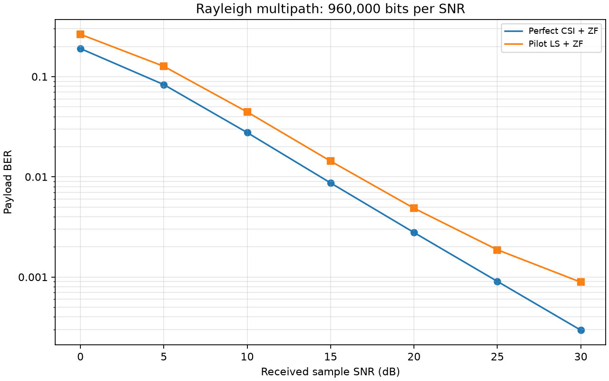

# NeuralOFDM

**Deep Learning-Based Channel Estimation and Equalization for OFDM Communication Systems**

This is my project on channel estimation for OFDM. I built it in stages:

1. **Baseline:** a simple OFDM link (QPSK, pilots, cyclic prefix, multipath channel,
   noise) with a pilot-based LS channel estimate and zero-forcing (ZF) equalization.
   I checked every block before trusting any BER curve.
2. **Classical benchmark:** I added an LMMSE channel estimator, Rician fading,
   16-QAM and a fixed-noise mode, and compared Perfect CSI, LS and LMMSE on the
   same received frames.
3. **Residual CNN:** a small neural network that takes the LS estimate and
   tries to clean it up before the normal equalizer.
4. **Attention comparison:** a small Transformer and a CNN/Transformer hybrid
   compared against the CNN, LS and LMMSE.

Stages 1 and 2 are finished and their results are below. For stages 3 and 4 the
code, tests and experiment configs are written, but the networks still have to be
trained on my machine, so there are no neural results yet.

```text
bits -> QPSK or 16-QAM -> data + pilot grid -> IFFT -> add CP
     -> multipath channel + noise -> remove CP -> FFT
     -> channel estimate (Perfect CSI / LS / LMMSE / neural) -> ZF -> bits -> BER
                                         true H vs estimated H -> NMSE
```

For the neural stages, the network only refines the LS estimate. Equalization and
demodulation stay classical:

```text
                    +-> residual CNN -------+
H_LS (from pilots) -+-> Transformer --------+-> refined H -> ZF -> decisions -> BER
                    +-> CNN/Transformer ----+
```

## Setup

I use Python 3.12 and [uv](https://docs.astral.sh/uv/). `uv.lock` pins every package.
Run everything from the project folder:

```powershell
uv sync --locked
uv run pytest -q --basetemp=.pytest-tmp
uv run ruff check .
uv run ruff format --check .
```

PyTorch is only needed for the neural stages. It is an optional extra:

```powershell
uv sync --locked --extra neural
```

The lock file points at the CUDA 12.8 build of torch 2.9.1. On a machine without an
NVIDIA GPU the same build still runs on the CPU.

## Stage 1: baseline

```powershell
uv run jupyter lab notebooks/01_classical_ofdm_baseline.ipynb
uv run python scripts/validate_notebook.py
uv run python scripts/run_ber_sweep.py --frames 10000 --seed 2026 --channel fixed --output results/baseline_fixed
uv run python scripts/run_ber_sweep.py --frames 10000 --seed 2026 --channel rayleigh --output results/baseline_rayleigh
```

The notebook goes through the link one block at a time and saves its figures to
`results/baseline_demo/`. The sweep script also takes `--snr-start`, `--snr-stop`,
`--snr-step` and `--demo-figures` (`--help` shows the defaults). Each sweep saves:

- `metrics.csv`: bit error counts, BER, mean NMSE and how many bins ZF had to clamp;
- `metadata.json`: seed, pilot layout, channel settings, SNR definition and package versions;
- `ber_vs_snr.png` and `nmse_vs_snr.png`.

Results with seed 2026 and 10,000 frames per SNR (960,000 payload bits per point).
Both receivers see exactly the same frames and both use ZF. NMSE is linear.

| SNR (dB) | Fixed BER perfect | Fixed BER LS | Fixed LS NMSE | Rayleigh BER perfect | Rayleigh BER LS | Rayleigh LS NMSE |
|---:|---:|---:|---:|---:|---:|---:|
| 0 | 0.17494 | 0.24979 | 0.68745 | 0.19049 | 0.26432 | 0.68418 |
| 10 | 0.008608 | 0.018420 | 0.068825 | 0.027623 | 0.044381 | 0.069473 |
| 15 | 0.0001833 | 0.0008854 | 0.021825 | 0.0086854 | 0.014335 | 0.022762 |
| 20 | 0 observed | 0.000001042 | 0.0069622 | 0.0027781 | 0.0048552 | 0.0079868 |
| 30 | 0 observed | 0 observed | 0.00077587 | 0.00029479 | 0.00088854 | 0.0018333 |

The CSV files have all seven SNR points. Zero errors in my run does not mean the
true BER is zero. With 960,000 bits, a rough 95% upper bound is about `3.12e-6`, and
that bound assumes independent bits, which is not really true with fading. In the
plots I show these bounds as separate triangles instead of joining them to the
BER line. The single LS error at 20 dB is too little to say anything precise.

Even with no noise, LS on the fixed channel has an NMSE of about **8.85e-5**
(-40.53 dB) because straight-line interpolation between pilots is not exact.



## Stage 2: classical benchmark

```powershell
uv run python scripts/run_classical_benchmark.py --frames 3000 --seed 2026
uv run python scripts/run_classical_benchmark.py --plots-only
uv run python scripts/validate_notebook.py notebooks/02_classical_channel_estimation.ipynb
```

I ran nine studies (saved in `results/classical_benchmark/`): the main receiver
comparison, pilot spacing 2/4/8, QPSK vs 16-QAM, Rayleigh vs Rician K=1/10, and
LMMSE with wrong channel statistics. Each point uses 3,000 frames at reference
Es/N0 = 0, 5, ..., 30 dB. Here the noise variance is fixed at
`sigma^2=10^(-reference_esn0_db/10)` (with Es=1), so deep fades really do lower
the received SNR. This axis is different from the SNR used in stage 1, and neither
one is Eb/N0.

At 15 dB on the Rayleigh channel with pilot spacing 4, I measured BER **0.03004 for
LS** and **0.01798 for LMMSE**, with mean NMSE **0.04785** and **0.01158**. At 30 dB
LMMSE got **0.0006181** while LS stayed at **0.007802**. LS levels off because a
straight line between pilots cannot follow this channel exactly. Each receiver had
288,000 payload bits per point. The full numbers and derivations are in the
[classical benchmark report](CLASSICAL_BENCHMARK_REPORT.md).

## Stages 3 and 4: learned channel estimation

Main pieces:

- `configs/neural_channel_estimation/protocol.json`: the CNN experiment (data,
  models, seeds, test conditions).
- `configs/attention_channel_estimation/protocol.json`: the attention experiment.
  It reuses the CNN training data and settings and has its own fresh test set.
- `scripts/generate_dataset.py`, `scripts/train_channel_estimator.py`,
  `scripts/evaluate_channel_estimator.py`: one set of scripts for both experiments,
  picked with `--protocol`.
- `scripts/analyze_channel_conditions.py`: delay spread and pilot coverage for each
  test condition.

The whole run (tests, data, training and evaluation) is:

```powershell
uv sync --locked --extra neural
uv run --extra neural python scripts/generate_dataset.py --protocol configs/neural_channel_estimation/protocol.json
uv run --extra neural python scripts/generate_dataset.py --protocol configs/attention_channel_estimation/protocol.json --splits train validation test
uv run --extra neural python scripts/train_channel_estimator.py --protocol configs/neural_channel_estimation/protocol.json
uv run --extra neural python scripts/train_channel_estimator.py --protocol configs/attention_channel_estimation/protocol.json
uv run --extra neural python scripts/evaluate_channel_estimator.py --protocol configs/neural_channel_estimation/protocol.json
uv run --extra neural python scripts/evaluate_channel_estimator.py --protocol configs/attention_channel_estimation/protocol.json
```

Training data: 30,000 Rayleigh frames with reference Es/N0 drawn uniformly between
0 and 30 dB, plus 4,000 validation frames. Every frame has its own channel, so no
channel is shared between training, validation and test. The networks only get
the LS estimate (real and imaginary parts, shape `[batch, 2, 64]`). They are not
told the noise level. Results will be added here once training is done.

## Project layout

```text
neural-ofdm/
|-- pyproject.toml, uv.lock, README.md
|-- BASELINE_REPORT.md, CLASSICAL_BENCHMARK_REPORT.md
|-- configs/
|   |-- neural_channel_estimation/protocol.json
|   `-- attention_channel_estimation/protocol.json
|-- src/neural_ofdm/
|   |-- config.py, modulation.py, ofdm.py, channel.py     OFDM link
|   |-- estimation.py, equalization.py, metrics.py         LS, LMMSE, ZF/MMSE, BER/NMSE
|   |-- simulation.py, experiments.py, benchmark.py        frames and experiments
|   |-- plotting.py, benchmark_plotting.py                 classical figures
|   |-- neural_data.py, neural_study.py                    datasets and experiment configs
|   |-- neural_models.py, transformer.py, hybrid.py, positional.py   networks
|   |-- neural_training.py, neural_evaluation.py, neural_timing.py   training, testing, timing
|   `-- neural_plotting.py, study_figures.py               neural figures
|-- tests/                                                 pytest suite
|-- notebooks/01_classical_ofdm_baseline.ipynb
|-- notebooks/02_classical_channel_estimation.ipynb
|-- scripts/                                               command-line tools
`-- results/                                               saved CSV/JSON/PNG results
```

Large datasets (`datasets/`) and checkpoints (`checkpoints/`) are not meant to be
committed; only small result files are.

## Conventions I kept the same everywhere

- **QPSK:** bits `(b_I,b_Q)` -> `((1-2*b_I) + j*(1-2*b_Q))/sqrt(2)`, Gray coded,
  energy one. Decisions use the sign of each part.
- **Grid:** 64 FFT bins, all used (including DC), in normal NumPy order. Pilots at
  0, 4, ..., 60, so 48 data bins and 96 payload bits per frame.
- **FFT:** the signal uses `norm="ortho"`. The channel response is the plain
  `fft(h, n=64)`. Together this gives `Y[k] = H[k] X[k] + W[k]` after removing the CP.
- **CP:** 16 samples, and it must be at least as long as the largest channel delay.
- **Channels:** a new random channel for every frame, normalized so the *average*
  energy is one (single frames are not rescaled). No Doppler.
- **Noise:** complex Gaussian with total variance `sigma^2`, half in the real part
  and half in the imaginary part.
- **LS:** received pilot / known pilot, then straight-line interpolation of the
  real and imaginary parts, wrapping around the edge of the band.
- **ZF:** divide by the channel estimate. Gains smaller than `1e-10` are clamped
  (with a warning and a count), but a real null can't be undone this way.
- **Metrics:** BER counts payload bits only. NMSE uses all 64 bins and is averaged
  per frame in linear units before converting to dB.

All random numbers come from explicit seeded generators, and every receiver in a
comparison sees exactly the same frames.

## Limitations

Timing is perfect and there is no coding, synchronization, MIMO, Doppler or real
cellular frame structure. The channels are simple random models, not a standard.
Zero observed errors never prove a zero error rate. LMMSE here is given the true
channel statistics and noise level, which a real receiver would have to estimate.
